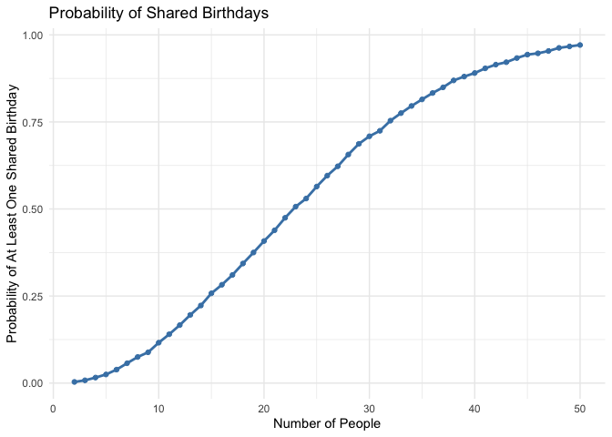
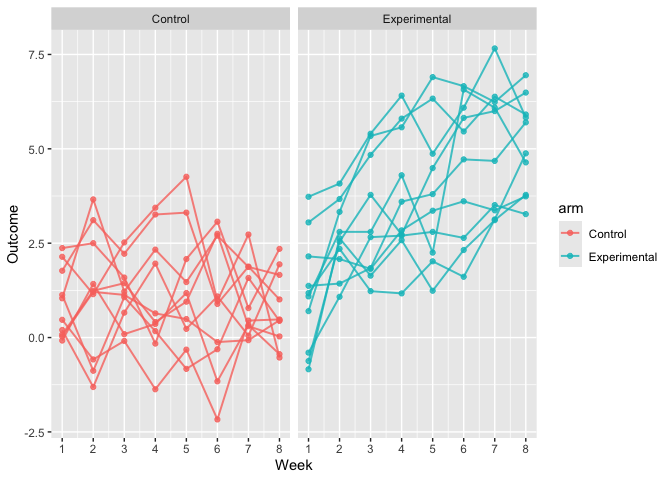
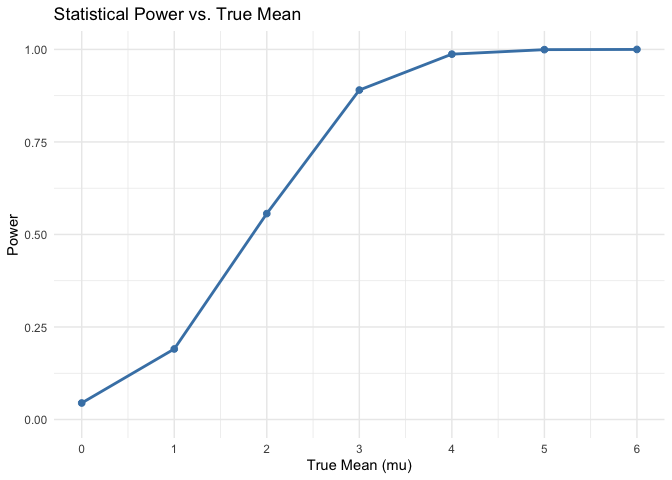
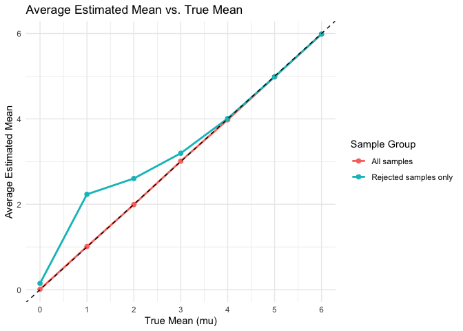

P8105 Homework 5
================
Chengshun Zhao

## Problem 1

``` r
birthday_match = function(n) {
  birthdays = sample(1:365, size = n, replace = TRUE)
  any(duplicated(birthdays))
}

set.seed(123)
birthday_match(23)
```

    ## [1] TRUE

``` r
set.seed(123)

group_sizes = 2:50

probabilities = sapply(group_sizes, function(n) {
  mean(replicate(10000, birthday_match(n)))
})

birthday_results = data.frame(
  group_size = group_sizes,
  probability = probabilities
)

head(birthday_results)
```

    ##   group_size probability
    ## 1          2      0.0033
    ## 2          3      0.0079
    ## 3          4      0.0158
    ## 4          5      0.0248
    ## 5          6      0.0387
    ## 6          7      0.0570

``` r
library(ggplot2)

ggplot(birthday_results, aes(x = group_size, y = probability)) +
  geom_line(color = "steelblue", linewidth = 1) +
  geom_point(color = "steelblue", size = 1.5) +
  labs(
    title = "Probability of Shared Birthdays",
    x = "Number of People",
    y = "Probability of At Least One Shared Birthday"
  ) +
  theme_minimal()
```

<!-- -->

The simulation shows that the probability of at least two people sharing
a birthday increases as group size increases. The probability is
approximately 50% with 23 people and exceeds 90% with around 41 people.
This illustrates how shared birthdays become increasingly likely even in
relatively small groups.

## Problem 2

``` r
library(tidyverse)
```

    ## ── Attaching core tidyverse packages ──────────────────────── tidyverse 2.0.0 ──
    ## ✔ dplyr     1.2.1     ✔ readr     2.2.0
    ## ✔ forcats   1.0.1     ✔ stringr   1.6.0
    ## ✔ lubridate 1.9.5     ✔ tibble    3.3.1
    ## ✔ purrr     1.2.2     ✔ tidyr     1.3.2
    ## ── Conflicts ────────────────────────────────────────── tidyverse_conflicts() ──
    ## ✖ dplyr::filter() masks stats::filter()
    ## ✖ dplyr::lag()    masks stats::lag()
    ## ℹ Use the conflicted package (<http://conflicted.r-lib.org/>) to force all conflicts to become errors

``` r
file_data = tibble(
  file_name = list.files(
    path = "data",
    pattern = "\\.csv$",
    full.names = TRUE
  )
)

file_data = file_data |>
  mutate(
    subject_data = purrr::map(file_name, readr::read_csv,
                              show_col_types = FALSE)
  )

print(file_data, n = 20)
```

    ## # A tibble: 20 × 2
    ##    file_name       subject_data      
    ##    <chr>           <list>            
    ##  1 data/con_01.csv <spc_tbl_ [1 × 8]>
    ##  2 data/con_02.csv <spc_tbl_ [1 × 8]>
    ##  3 data/con_03.csv <spc_tbl_ [1 × 8]>
    ##  4 data/con_04.csv <spc_tbl_ [1 × 8]>
    ##  5 data/con_05.csv <spc_tbl_ [1 × 8]>
    ##  6 data/con_06.csv <spc_tbl_ [1 × 8]>
    ##  7 data/con_07.csv <spc_tbl_ [1 × 8]>
    ##  8 data/con_08.csv <spc_tbl_ [1 × 8]>
    ##  9 data/con_09.csv <spc_tbl_ [1 × 8]>
    ## 10 data/con_10.csv <spc_tbl_ [1 × 8]>
    ## 11 data/exp_01.csv <spc_tbl_ [1 × 8]>
    ## 12 data/exp_02.csv <spc_tbl_ [1 × 8]>
    ## 13 data/exp_03.csv <spc_tbl_ [1 × 8]>
    ## 14 data/exp_04.csv <spc_tbl_ [1 × 8]>
    ## 15 data/exp_05.csv <spc_tbl_ [1 × 8]>
    ## 16 data/exp_06.csv <spc_tbl_ [1 × 8]>
    ## 17 data/exp_07.csv <spc_tbl_ [1 × 8]>
    ## 18 data/exp_08.csv <spc_tbl_ [1 × 8]>
    ## 19 data/exp_09.csv <spc_tbl_ [1 × 8]>
    ## 20 data/exp_10.csv <spc_tbl_ [1 × 8]>

``` r
tidy_data = file_data |>
  mutate(
    file = basename(file_name),
    arm = if_else(
      str_starts(file, "con"),
      "Control",
      "Experimental"
    ),
    subject_id = str_extract(file, "\\d+")
  ) |>
  select(subject_id, arm, subject_data) |>
  unnest(cols = subject_data) |>
  pivot_longer(
    cols = starts_with("week"),
    names_to = "week",
    values_to = "observation"
  ) |>
  mutate(
    week = as.numeric(str_extract(week, "\\d+")),
    observation = as.numeric(observation)
  ) |>
  arrange(arm, subject_id, week)

# Check the tidy data
print(head(tidy_data, 12))
```

    ## # A tibble: 12 × 4
    ##    subject_id arm      week observation
    ##    <chr>      <chr>   <dbl>       <dbl>
    ##  1 01         Control     1        0.2 
    ##  2 01         Control     2       -1.31
    ##  3 01         Control     3        0.66
    ##  4 01         Control     4        1.96
    ##  5 01         Control     5        0.23
    ##  6 01         Control     6        1.09
    ##  7 01         Control     7        0.05
    ##  8 01         Control     8        1.94
    ##  9 02         Control     1        1.13
    ## 10 02         Control     2       -0.88
    ## 11 02         Control     3        1.07
    ## 12 02         Control     4        0.17

``` r
ggplot(
  tidy_data,
  aes(
    x = week,
    y = observation,
    group = interaction(arm, subject_id),
    color = arm
  )
) +
  geom_line(linewidth = 0.7, alpha = 0.8) +
  geom_point(size = 1.5, alpha = 0.8) +
  facet_grid(. ~ arm) +
  scale_color_manual(
    values = c(
      "Control" = "#F8766D",
      "Experimental" = "#00BFC4"
    )
  ) +
  scale_x_continuous(breaks = 1:8) +
  labs(
    x = "Week",
    y = "Outcome",
    color = "arm"
  ) +
  theme_gray()
```

<!-- -->

The experimental group shows an increasing trend over time, while the
control group remains relatively stable. By week 8, the experimental
group generally has higher outcome values than the control group.

## Problem 3

``` r
library(tidyverse)
library(broom)

set.seed(123)

simulate_t_test = function(mu) {

  sample_data = rnorm(
    n = 30,
    mean = mu,
    sd = 5
  )

  test_result = t.test(
    sample_data,
    mu = 0
  )

  broom::tidy(test_result) |>
    select(estimate, p.value)
}

simulate_t_test(mu = 0)
```

    ## # A tibble: 1 × 2
    ##   estimate p.value
    ##      <dbl>   <dbl>
    ## 1   -0.236   0.794

``` r
set.seed(123)

simulation_results = purrr::map_dfr(
  0:6,
  function(current_mu) {

    purrr::map_dfr(
      1:5000,
      function(i) {
        simulate_t_test(current_mu)
      }
    ) |>
      mutate(mu = current_mu)

  }
) |>
  select(mu, estimate, p.value)

# Check the results
head(simulation_results, 10)
```

    ## # A tibble: 10 × 3
    ##       mu estimate p.value
    ##    <int>    <dbl>   <dbl>
    ##  1     0  -0.236   0.794 
    ##  2     0   0.892   0.252 
    ##  3     0   0.122   0.879 
    ##  4     0  -0.469   0.575 
    ##  5     0  -0.918   0.388 
    ##  6     0   0.769   0.379 
    ##  7     0   0.0735  0.934 
    ##  8     0  -0.448   0.578 
    ##  9     0   0.254   0.789 
    ## 10     0   1.68    0.0483

``` r
nrow(simulation_results)
```

    ## [1] 35000

``` r
power_results = simulation_results |>
  group_by(mu) |>
  summarize(
    power = mean(p.value < 0.05),
    .groups = "drop"
  )

print(power_results)
```

    ## # A tibble: 7 × 2
    ##      mu  power
    ##   <int>  <dbl>
    ## 1     0 0.0446
    ## 2     1 0.191 
    ## 3     2 0.556 
    ## 4     3 0.890 
    ## 5     4 0.987 
    ## 6     5 0.999 
    ## 7     6 1

``` r
# Plot power against the true mean
ggplot(power_results, aes(x = mu, y = power)) +
  geom_line(color = "steelblue", linewidth = 1) +
  geom_point(color = "steelblue", size = 2) +
  scale_x_continuous(breaks = 0:6) +
  scale_y_continuous(limits = c(0, 1)) +
  labs(
    title = "Statistical Power vs. True Mean",
    x = "True Mean (mu)",
    y = "Power"
  ) +
  theme_minimal()
```

<!-- -->

``` r
estimate_results = simulation_results |>
  group_by(mu) |>
  summarize(
    overall_mean = mean(estimate),
    rejected_mean = mean(estimate[p.value < 0.05]),
    .groups = "drop"
  )

print(estimate_results)
```

    ## # A tibble: 7 × 3
    ##      mu overall_mean rejected_mean
    ##   <int>        <dbl>         <dbl>
    ## 1     0      0.00900         0.147
    ## 2     1      1.01            2.23 
    ## 3     2      1.99            2.60 
    ## 4     3      3.01            3.20 
    ## 5     4      3.98            4.01 
    ## 6     5      4.98            4.99 
    ## 7     6      5.99            5.99

``` r
ggplot(estimate_results, aes(x = mu)) +
  geom_line(
    aes(y = overall_mean, color = "All samples"),
    linewidth = 1
  ) +
  geom_point(
    aes(y = overall_mean, color = "All samples"),
    size = 2
  ) +
  geom_line(
    aes(y = rejected_mean, color = "Rejected samples only"),
    linewidth = 1
  ) +
  geom_point(
    aes(y = rejected_mean, color = "Rejected samples only"),
    size = 2
  ) +
  geom_abline(
    slope = 1,
    intercept = 0,
    linetype = "dashed"
  ) +
  scale_x_continuous(breaks = 0:6) +
  labs(
    title = "Average Estimated Mean vs. True Mean",
    x = "True Mean (mu)",
    y = "Average Estimated Mean",
    color = "Sample Group"
  ) +
  theme_minimal()
```

<!-- -->
Power: Statistical power increases as the true mean moves farther from
zero. Larger effect sizes are more likely to be detected.

Mean estimates: The average estimates across all samples are close to
the true means. However, estimates from rejected tests tend to
overestimate smaller positive effects because only statistically
significant results are selected. This difference becomes smaller as
statistical power increases.
